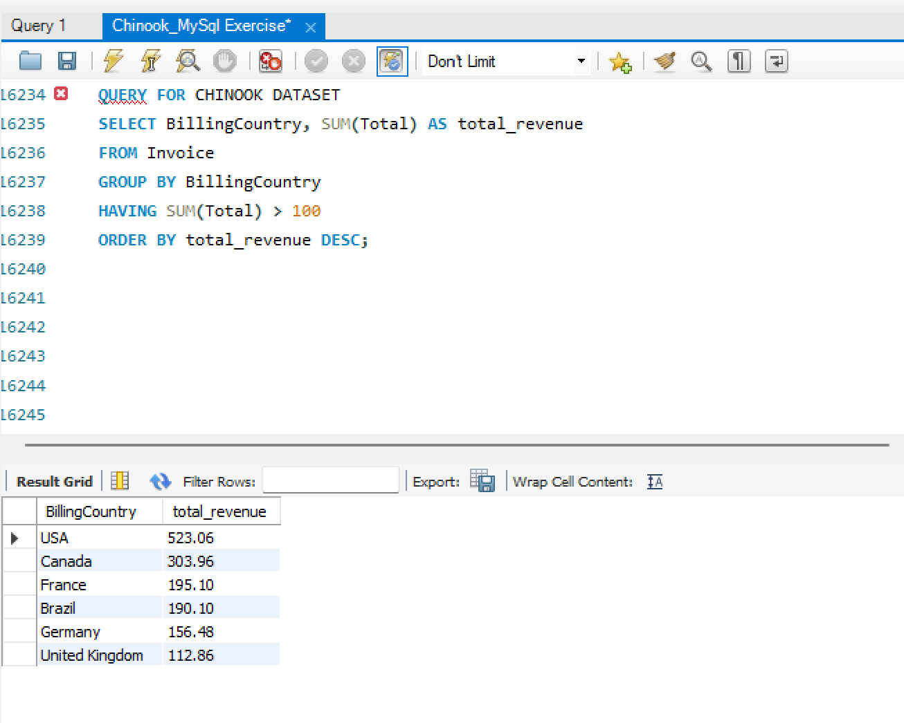

# Revenue by Country

**Business question:** Which countries generate more than 100 in total revenue?

**Skills used:** Aggregation, GROUP BY, HAVING

## Query
```sql
SELECT BillingCountry, SUM(Total) AS total_revenue
FROM Invoice
GROUP BY BillingCountry
HAVING SUM(Total) > 100
ORDER BY total_revenue DESC;
```

## Result


## Insight
Six countries generate more than 100 in revenue. The USA leads with 523.06, about 22% of the 2,328.60 total, followed by Canada (303.96) and France (195.10).
